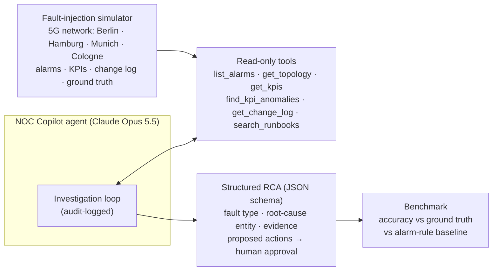

# 📡 NOC Copilot: agentic AI for 5G network operations

**An AI agent that investigates mobile-network incidents the way a NOC engineer does.** It reads alarms, KPIs and change logs through read-only tools, finds the root cause, and proposes remediation that a human approves. It ships with a fault-injection simulator and a benchmark, so its accuracy is *measured* against ground truth, not demoed.


> Built by a telecom SDET moving into AI engineering. Telecom NOCs drown in alarms; classic correlation rules break the moment an alarm goes missing. This project asks: **can an agent that reasons over KPIs and change history close that gap, and can we prove it?**

---

## The problem

A single fibre cut can fire hundreds of alarms. NOC teams rely on correlation rules that map *known alarm patterns* to root causes. That works until reality gets messy:

- a router loses its management path and its own `LINK_DOWN` never arrives,
- a site's mains-power alarm is dropped by a telemetry gap,
- a bad parameter push degrades calls but raises **no alarm at all**.

Engineers then dig through KPIs, topology and change logs by hand. That is slow, and it's exactly the kind of multi-step investigation an LLM agent can do.

## How it works



| Piece | What it does |
|---|---|
| **Simulator** (`simulator.py`) | A 4-city 5G network (core, aggregation routers, 16 sites, 48 cells). Injects one of 5 faults: fibre cut, site power outage, core (UPF) congestion, bad config push, uplink interference. Adds realistic noise (door alarms, temperature, a cleared link flap, an unrelated config change) and optionally **drops the primary alarm**. |
| **Analytics** (`analytics.py`) | KPI anomaly detection (baseline vs recent window) and an **alarm-rule baseline** that works like a classic NOC rulebook. |
| **Agent** (`agent.py`) | Claude with 6 read-only tools in a manual loop. Every tool call is recorded in an audit trace, and the final answer is forced into an RCA JSON schema. |
| **Benchmark** (`benchmark.py`) | Runs any method over a balanced set of incidents and reports accuracy by fault type and by "alarms present / primary alarm missing". |

## Results

A case is correct only if **both** the fault type and the exact root-cause entity match. Incidents cover all 5 fault types; half have the primary alarm missing. Measured on 12 Oct 2026, effort `medium`:

| Method | Incidents | Overall | Alarms present | Primary alarm missing | Cost / incident | Time / incident |
|---|---|---|---|---|---|---|
| Alarm-rule baseline | 20 | **60%** | 100% | 20% | $0 | <1 ms |
| Claude Haiku 5.5 agent | 20 | **100%** | 100% | 100% | **$0.0023** | 11 s |
| Claude Opus 5.5 agent | 10 | **100%** | 100% | 100% | $0.080 | 17 s |

*Costs are computed from token usage at list prices. A full 20-incident run on Haiku costs about 5 cents.*

**What this shows:** the rulebook is perfect when every alarm arrives and collapses when the key alarm is missing. Both agents close that gap by working from KPIs, topology and the change log. In about 3 turns and 5-7 tool calls they find silent failures such as a bad automated config push that raised no alarm at all. The small model matches the large one here at about 1/35 of the cost.

**Honest limitation:** 100% means this benchmark is now *too easy* for current models: each incident has one clean root cause. The next version adds harder cases (two simultaneous faults, cascading failures, misleading alarms) to find where agents actually break.

<details>
<summary>Example: Haiku investigating a silent config-change fault (no alarms raised)</summary>

```text
Audit trail:
  turn 1: list_alarms({"min_severity": "WARNING"})
  turn 1: find_kpi_anomalies({})
  turn 1: get_change_log({})
  turn 2: get_kpis({"entity_id": "SITE-HAM-002"})
  turn 2: get_topology({"entity_id": "SITE-HAM-002"})
  turn 2: search_runbooks({"query": "A3 handover offset mobility parameter change drop call rate"})

3 turns, 6 tool calls, 9788+1583 tokens, 13.97s, $0.0018

Root cause : CONFIG_CHANGE at SITE-HAM-002  (confidence: high)
  evidence : Change log: 10:57Z SITE-HAM-002, son-automation, A3 handover offset 3 dB -> 12 dB on all cells.
  evidence : drop_call_rate_pct up ~840% on all three cells; availability, throughput, interference unchanged.
  evidence : No alarms were raised for HAM-002 at WARNING or above, so the degradation is silent.
  evidence : SITE-BER-002 neighbour-list change has no associated KPI anomaly, so it is discounted.
  PROPOSED [low risk, needs approval]: Roll back the A3 handover offset on SITE-HAM-002 to 3 dB.
  PROPOSED [low risk, needs approval]: Pause the son-automation mobility policy until reviewed.

Ground truth: CONFIG_CHANGE at SITE-HAM-002 -> CORRECT
```
</details>

## Quick start

```bash
git clone https://github.com/abpandey-dev/noc-copilot.git && cd noc-copilot
python -m venv .venv && source .venv/bin/activate
pip install -e ".[dev]"

noc simulate --seed 9                    # look at an incident (no answer shown)
noc triage --seed 9 --method baseline    # rule-based RCA
noc benchmark --method baseline --n 20   # score the baseline
pytest -q                                # 71 tests, no API key needed
```

With Claude (needs `ANTHROPIC_API_KEY` or `ant auth login`; real calls cost money, so start with one incident):

```bash
noc triage --seed 9 --method claude --trace
noc benchmark --method claude --model claude-haiku-5-5 --n 20   # ~5 cents
```

Example incident (`noc simulate --seed 4`): core congestion with noise around it:

```text
2026-10-12T10:20:00Z  MINOR    ACTIVE  SITE-CGN-004       HIGH_TEMPERATURE
2026-10-12T10:40:00Z  MINOR    CLEARED SITE-HAM-002       LINK_FLAP
2026-10-12T11:02:00Z  MAJOR    ACTIVE  CORE-FRA-UPF1      UPF_CPU_HIGH
2026-10-12T11:04:00Z  MINOR    ACTIVE  CORE-FRA-UPF1      GTPU_PATH_DEGRADED
2026-10-12T11:20:00Z  WARNING  ACTIVE  SITE-MUC-002       DOOR_OPEN

Top KPI anomalies:
  CORE-FRA-UPF1      packet_loss_pct            0.05 -> 2.08     (+4122.8%)
  CORE-FRA-UPF1      latency_ms                11.76 -> 86.23    (+633.3%)
  SITE-CGN-001-C2    dl_throughput_mbps        151.0 -> 86.53    (-42.7%)
```

## Responsible AI by design

Network operations is critical infrastructure, so the design follows the spirit of the **EU AI Act's human-oversight requirements**:

- **Read-only tools.** The agent can look at anything but change nothing.
- **Human in the loop.** Every recommended action is a proposal with a risk level and `requires_human_approval: true`.
- **Audit trail.** Every tool call (turn, tool, input, errors) is recorded for review.
- **Measured, not assumed.** A ground-truth benchmark and a non-AI baseline show exactly where the agent helps and where it doesn't.
- **Synthetic data only.** No real network, customer or operator data is used.

## Project layout

```text
src/noc_copilot/
  topology.py     # core → aggregation routers → sites → cells
  simulator.py    # fault injection + noise + alarm loss, with ground truth
  analytics.py    # KPI anomaly detection + alarm-rule baseline
  tools.py        # 6 read-only tools (strict JSON schemas)
  agent.py        # Claude investigation loop, audit trace, structured RCA
  models.py       # RCA contract (pydantic + JSON schema)
  benchmark.py    # scoring and reports
  cli.py          # `noc` command
  runbooks/       # NOC runbooks the agent can search
tests/            # 71 tests incl. agent loop with a scripted fake client
```

## Roadmap

- [x] Publish Claude benchmark numbers and cost per incident (Haiku 5.5 and Opus 5.5)
- [ ] Harder benchmark: multi-fault incidents (two problems at once), cascading failures, misleading alarms
- [ ] Streaming alarms (Kafka) instead of a fixed incident window
- [ ] O-RAN / 3GPP-style KPI names and a larger topology
- [ ] Web dashboard: incident timeline, topology map, agent trace

---

*Independent personal project. All data is synthetic; not affiliated with any network operator.*
